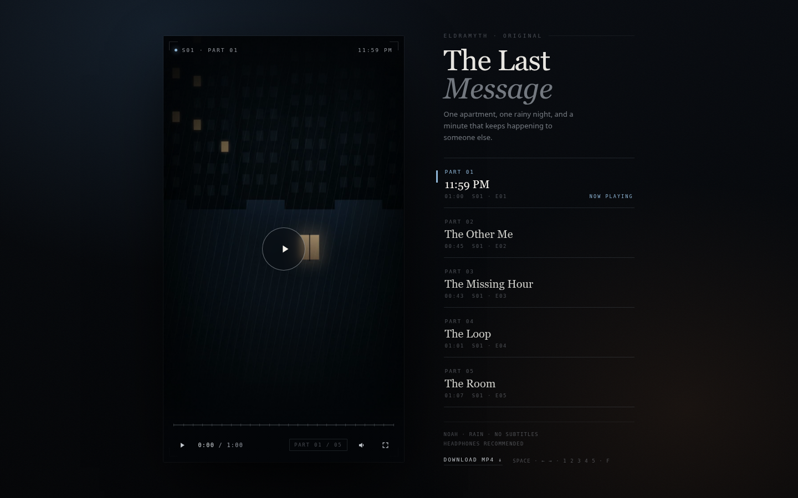
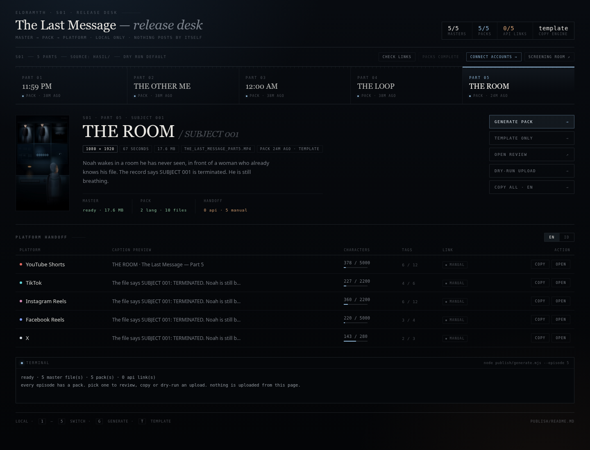
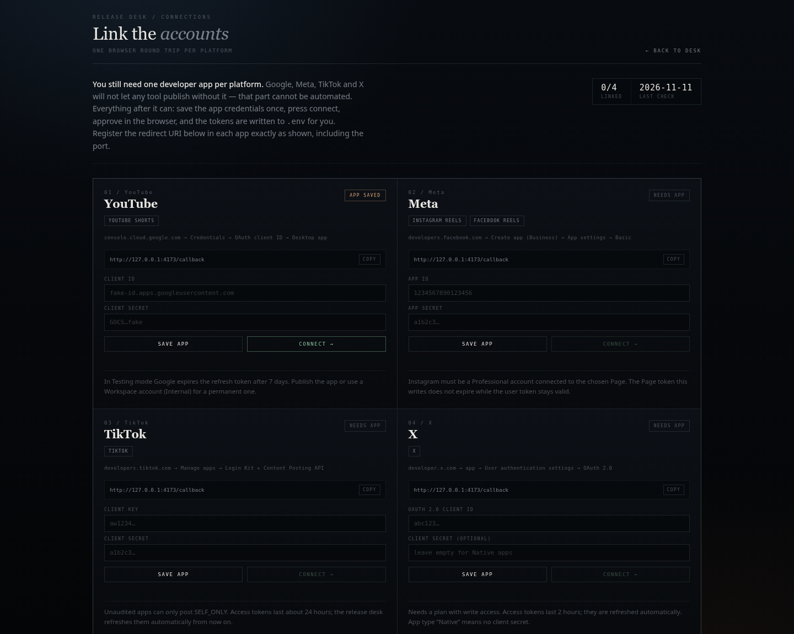

# THE LAST MESSAGE

**A twenty-part animated psychological thriller, in two seasons.**
One apartment, one rainy night, and a minute that keeps happening to someone else.



*The screening room — every episode, one player.*

> **Source-available, not open source.** The code is public to read and study.
> The story, characters, artwork and episodes may not be reused, re-uploaded or
> built upon without written permission. See [Licensing](#licensing).

---

## What this is

A serialized 2D anime short, written and voiced by EldraMyth, built entirely in
code with **React + Remotion**. No stock footage, no AI video: every frame is
vector artwork — character rigs, rain, monitors, lighting — composed in React and
rendered to 1080 × 1920 vertical video.

The series follows Noah. At 11:59 PM an unknown number tells him not to open his
door. Over ten parts, the hallway, the clock, and the messages stop behaving
like things that belong to him, until the laboratory underneath the building
starts behaving like it has been waiting for him.

### Season 01 — one minute

| Part | Title | Runtime | Frames |
|---|---|---|---|
| 01 | **11:59 PM** | 1:00 | 1800 |
| 02 | **The Other Me** | 0:45 | 1358 |
| 03 | **12:00 AM** *(The Missing Hour)* | 0:43 | 1304 |
| 04 | **The Loop** | 1:01 | 1816 |
| 05 | **The Room** *(Subject 001)* | 1:07 | 2020 |
| 06 | **DON'T TRUST NOAH.** *(Subject 002)* | 1:23 | 2497 |
| 07 | **SHE SENT IT HERSELF** *(Subject 002)* | 1:14 | 2212 |
| 08 | **THE SECOND AMARA** | 1:18 | 2329 |
| 09 | **THE FIRST EXPERIMENT** *(Project Origin)* | 1:34 | 2831 |
| 10 | **THE ORIGINAL SIN** *(Project Eden)* | 2:04 | 3733 |

### Season 02 — PROJECT EDEN

Season 2 leaves the apartment. The door Noah was told never to open opens onto a
floor that was never on the plans, and every face down there is his.

| Part | Title | Runtime | Frames |
|---|---|---|---|
| 01 | **THE EDEN SIGNAL** | 0:43 | 1281 |
| 02 | **THE EMPTY CITY** | 0:42 | 1262 |
| 03 | **THE ARCHIVE** | 0:48 | 1432 |
| 04 | **THE FALSE MEMORY** | 0:44 | 1320 |
| 05 | **THE WITNESS** | 0:41 | 1228 |
| 06 | **THE DIVIDE** | 0:41 | 1221 |
| 07 | **THE SOURCE** | 0:41 | 1228 |
| 08 | **THE AWAKENING** | 0:39 | 1178 |
| 09 | **THE EDEN PROTOCOL** | 0:44 | 1315 |
| 10 | **THE OTHER SIDE** | 0:47 | 1406 |

Season 2 is model-agnostic by contract: the frame count is `floor(audio_seconds ×
30)` measured from the MP3 that is actually in `public/audio/`, and the cuts sit
on words measured with Whisper — never on the timestamps written in the bible.
`npm run lock` checks that before every render. Each episode folder keeps an
`S02ENN.audio.json` with the voice, the duration, the frame count and the sha256
of the MP3, so a regenerated narration only means new landmarks, not a new edit.

Each episode is 1080 × 1920, 30 fps, H.264 + AAC, with the supplied narration
kept intact — pauses, breaths and room tone included.

**The masters are not in this repository.** They are private deliverables; the
repository ships the code that renders them plus poster frames. See
[Licensing](#licensing) before asking for a copy.

---

## Repository layout

```
.
├─ HASIL/            posters, screening room UI (masters excluded)
├─ BAHAN/            source audio and storyboards per part
├─ public/           fonts, textures, rain, narration used at render time
├─ src/
│  ├─ character/     vector rigs — Noah, Amara, Dr. Elias
│  ├─ Episode.tsx    Part 1 + shared camera/room/grain components
│  ├─ kit/           shared chrome for Parts 7–10: watermark, monitors,
│  │                 control wall, phone UI, NoahBack, helpers
│  ├─ kit2/          Season 2 atmosphere: Night, Haze, Grade, Skyline, Street
│  ├─ kit3/          Season 2 sets and figures: Chamber, Iris, Walker, MapWall
│  ├─ Part2–Part10.tsx   Season 1 episodes
│  ├─ S02E01–S02E10.tsx  Season 2 episodes
│  └─ c5, c7 … c25.tsx   render entry points per episode
├─ publish/          release desk: captions, review pages, upload adapters
├─ docs/             screenshots used by this README
└─ out/              working renders (not committed)
```

`HASIL/` holds the presentation layer — posters and the screening-room player.
`src/` holds the code that renders the episodes themselves. Episode masters stay
on the author's machine and are excluded by `.gitignore`.

---

## Requirements

- Node.js 20+ (developed on 24)
- npm
- Chrome/Chromium (Remotion renders with it)
- ~2 GB free disk for working renders

```bash
npm install
```

---

## Watch

Copy your own masters into `HASIL/` using the names the player expects
(`THE_LAST_MESSAGE_Part1.mp4` … `Part10.mp4`), then open
[`HASIL/index.html`](HASIL/index.html). The screening room plays all ten parts,
remembers where you are, and keeps the poster frames.

If you only have a clone, the player still runs and shows the poster rail — the
videos are simply absent. Render your own with the commands below.

For the dashboard workflow described below:

```bash
npm run dashboard
```

---

## Rendering

Render through the per-part entry points. Do **not** use `src/index.ts` — it can
fail with `delayRender() "Loading root component"`.

```bash
# Part 1 — 60.0 s
npx remotion render src/c5.tsx  Episode out/part1.mp4 --timeout=120000 --concurrency=3 --crf=19

# Part 2 — 45.3 s
npx remotion render src/c7.tsx  Part2   out/part2.mp4 --timeout=120000 --concurrency=3 --crf=19

# Part 3 — 43.5 s
npx remotion render src/c8.tsx  Part3   out/part3.mp4 --timeout=120000 --concurrency=3 --crf=19

# Part 4 — 60.5 s
npx remotion render src/c9.tsx  Part4   out/part4.mp4 --timeout=120000 --concurrency=3 --crf=19

# Part 5 — 67.3 s
npx remotion render src/c10.tsx Part5   out/part5.mp4 --timeout=180000 --concurrency=3 --crf=19

# Part 6 — 83.2 s
npx remotion render src/c11.tsx Part6   out/part6.mp4 --timeout=240000 --concurrency=3 --crf=19

# Part 7 — 73.7 s  (Subject 002, one live monitor)
npx remotion render src/c12.tsx Part7   out/part7.mp4 --timeout=300000 --concurrency=3 --crf=19

# Part 8 — 77.6 s  (The Second Amara)
npx remotion render src/c13.tsx Part8   out/part8.mp4 --timeout=300000 --concurrency=3 --crf=19

# Part 9 — 94.4 s  (The First Experiment)
npx remotion render src/c14.tsx Part9   out/part9.mp4 --timeout=300000 --concurrency=3 --crf=19

# Part 10 — 124.4 s (season finale, the sealed chamber)
npx remotion render src/c15.tsx Part10  out/part10.mp4 --timeout=300000 --concurrency=3 --crf=19

# ---- Season 02 ----
npx remotion render src/c16.tsx S02E01 out/s02e01.mp4 --timeout=240000 --concurrency=3 --crf=19
npx remotion render src/c17.tsx S02E02 out/s02e02.mp4 --timeout=240000 --concurrency=3 --crf=19
npx remotion render src/c18.tsx S02E03 out/s02e03.mp4 --timeout=240000 --concurrency=3 --crf=19
npx remotion render src/c19.tsx S02E04 out/s02e04.mp4 --timeout=240000 --concurrency=3 --crf=19
npx remotion render src/c20.tsx S02E05 out/s02e05.mp4 --timeout=240000 --concurrency=3 --crf=19
npx remotion render src/c21.tsx S02E06 out/s02e06.mp4 --timeout=240000 --concurrency=3 --crf=19
npx remotion render src/c22.tsx S02E07 out/s02e07.mp4 --timeout=240000 --concurrency=3 --crf=19
npx remotion render src/c23.tsx S02E08 out/s02e08.mp4 --timeout=240000 --concurrency=3 --crf=19
npx remotion render src/c24.tsx S02E09 out/s02e09.mp4 --timeout=240000 --concurrency=3 --crf=19
npx remotion render src/c25.tsx S02E10 out/s02e10.mp4 --timeout=240000 --concurrency=3 --crf=19

# contract check — canvas, fps, frames vs audio, watermark, no tracked masters
npm run lock
```

Grab a single frame while tuning a shot:

```bash
npx remotion still src/c10.tsx Part5 out/frame.png --frame=110
```

### Narration from the terminal

The narration can be generated without opening the ElevenLabs website. The key
goes in `.env` once (copy `.env.example`), then everything else is a command:

```bash
cp .env.example .env
echo 'ELEVENLABS_API_KEY=sk_...' >> .env

npm run voices                                # every account: credits and voice names
npm run tts -- --models                       # model ids and their limits
npm run tts -- --part 11 --voice "Amara"      # reads BAHAN/pt11/*.md
npm run tts -- --part 11 --voice "Amara" --dry-run   # price it, spend nothing
```

Several accounts can share the work. Add as many keys as you like, and a key
that runs out is swapped mid-render without losing the script:

```bash
ELEVENLABS_API_KEY=sk_main
ELEVENLABS_API_KEY_2=sk_backup
ELEVENLABS_API_KEY_3=sk_third        # … up to _9
ELEVENLABS_API_KEYS=sk_a,sk_b        # or one comma-separated line
```

A `401 quota_exceeded` or an invalid key marks that account dead in
`out/tts-state.json`, the request moves to the next account, and the report line
`via account 2 · eleven_v4` shows exactly who paid for which paragraph. A long
script is also spread across accounts: each request goes to the first one with
enough characters left. `npm run voices` prints the remaining credits per
account, and `--account 2` (or `--account "main channel"`) pins one account when
you do not want rotation. Delete `out/tts-state.json` to retry keys that were
marked dead before their credits reset.

Model 4 (`eleven_v4`) is the default because it is the one that performs audio
tags — `[whispers]`, `[sighs]`, `[rain falling]`, `[music]`. If an account
refuses that model (not in the plan, retired, `model_not_found`), the request is
retried on the next model in `--fallback` instead of dying: by default
`eleven_multilingual_v2 → eleven_turbo_v2_5 → eleven_flash_v2_5`. Those older
models read `[tags]` aloud, so they are stripped automatically and the report
says `tags dropped for an older model — check the take`. Set your own chain with
`--fallback a,b` or `ELEVENLABS_MODEL_FALLBACK`, and `--no-fallback` when a take
must not be downgraded — then a refused model is an error, not a compromise.

A refused *voice* is the one case that stops immediately: no model or account
swap changes what the plan allows, and a quieter failure would just cost credits.

`--part N` reads the single `.md`/`.txt` script in `BAHAN/ptN/`, strips the
markdown (headings and asterisks would otherwise be read aloud), writes
`BAHAN/ptN/ptN.mp3`, copies it to `public/audio/ptN.mp3`, and prints the exact
`durationInFrames` for the matching `src/c*.tsx` entry — the frame count comes
from the real file, never from the brief.

Anything else is a flag: `--text "…"` for one line, `--file path.md` for a
script somewhere else, `--out file.mp3` to choose the destination, plus the
performance knobs `--stability`, `--similarity`, `--style`, `--speed`,
`--language` and `--format`. Long scripts are split on paragraph and sentence
boundaries, sent with `previous_text`/`next_text` so the prosody carries across
requests, and joined with ffmpeg. `--voice` accepts a name or an id.

Renders take roughly 15–25 minutes per part on three threads.

### Output contract

- 1080 × 1920, 30 fps, H.264 + AAC
- Full narration, never stretched or re-timed
- Small `EldraMyth` watermark, upper right
- On-screen text is limited to what the storyboard allows — in Part 5 that is
  `145`, `146`, `147`, `SUBJECT 001`, `STATUS: TERMINATED`, and
  `Find the room where you were born.` In Part 6 it is `11:59`, `12:00 AM`,
  `SUBJECT 002` and `DON'T TRUST NOAH.`, plus that same `Find the room where you
  were born.` line on Noah's phone, which the storyboard calls for as diegetic
  text. Parts 7–10 carry `MESSAGES`, `SUBJECT 002`, `He remembers you.`,
  `You were never Subject 002.`, `You were the one who created it.`,
  `THE FIRST EXPERIMENT`, `PROJECT ORIGIN`, `MEMORY SYNCHRONIZATION INITIATED`,
  `ACCESS DENIED`, `11:59 PM` / `12:00 AM`, `Thank you for remembering me.`,
  the coordinates `35.6812° N / 139.7671° E`, `PROJECT EDEN`, and — after the
  room goes black in the finale — `NOAH AND AMARA / WILL COME BACK / — SEASON 2`,
  the one card that speaks to the audience rather than to the characters.
  Everything else sits inside the fiction: phone screens, monitor labels, clocks
  and walls. There are no subtitles.
- Season 2 keeps its own, much shorter list: `11:59`, `12:01`, `SUBJECT 001`,
  `SUBJECT 002`, `DR. ELIAS`, `DON'T TRUST NOAH.`, `You have already been here.`,
  `Emotional attachment trial: successful.` and `Phase 3 is waiting.` — plus
  `Find the room where you were born.` on Noah's phone. No title cards, no
  season label on screen, no captions.
- A short black tail (Parts 1–7) or a fade to black inside the last spoken word
  (Parts 8–10), so the last frame is never clipped by players

---

## The release desk



`publish/` turns one vertical video into a publish pack: platform-specific
captions, hashtags, a review page, and upload adapters. It is not tied to this
series — point it at any folder of vertical videos and it behaves the same.

```bash
npm run setup                        # point the desk at a folder of videos
npm run pack -- --episode 5 --open   # captions for all five platforms
npm run pack:post -- --episode 5     # dry run: show exactly what would upload
npm run doctor                       # which accounts are actually linked
npm run dashboard                    # local control desk for all of the above
```

`npm run setup -- --dir ~/my-clips --series "Night Drive" --handle @nightdrive`
scans the folder, reads durations with `ffprobe`, grabs a poster per video with
`ffmpeg`, and writes `publish/config.json` plus `publish/episodes.json`. Existing
files are backed up, never silently overwritten. With no written brief and no
LLM key the desk still produces a clean caption from the title, part number and
runtime; a brief or an `LLM_API_KEY` makes it sharper.

What the pack contains:

```
publish/out/ep05/
├─ captions.json      source of truth (EN + ID, five platforms)
├─ review.html        edit, copy, checklist, open upload page
├─ youtube.en.txt     one file per platform per language
├─ tiktok.en.txt
└─ …
```

The review page is a local, self-contained HTML file: character counts against
each platform's real limit, editable fields, per-platform checklists, and a
button that opens the upload screen. Nothing posts by itself.

### Captions

Copy can be written by any OpenAI-compatible model (`LLM_API_KEY` in `.env`), by
hand-written briefs per episode in `publish/episodes.json`, or — with neither — by
a generic template that only uses the title, part number and runtime. Hashtags are
restricted to the pool in `config.json`, so the model cannot invent tags.
Languages are whatever you list in `config.languages`.

### Accounts — one click each



`npm run dashboard`, then open `/connect`. Paste an app's Client ID and secret
once, press **connect →**, approve in the browser, and the tokens are written to
`.env` for you. No token copying, no expiry babysitting: X (2 h) and TikTok
(24 h) access tokens refresh themselves from their refresh tokens.

The only manual part left is creating the developer app — Google, Meta, TikTok
and X all require it, so no tool can skip it. [`publish/CONNECT.md`](publish/CONNECT.md)
walks through each console, scope and redirect URI, plus the failure messages
that actually show up.

`npm run doctor` (or **check links** on the desk) then proves which account a
token belongs to, rather than merely that a token exists:

```
PLATFORM        STATUS    ACCOUNT          DETAIL
YouTube         linked    EldraMyth        channel UC…
Instagram       linked    @eldramyth       BUSINESS
TikTok          —         not configured   missing TIKTOK_ACCESS_TOKEN
```

Meta links Instagram and Facebook from a single app: pick the Page, and the Page
token plus `IG_USER_ID` are written together. Credentials live in `.env` at the
repository root (chmod 600, never committed). Uploads default to the most private
setting each platform allows: YouTube `private`, TikTok `SELF_ONLY`. Instagram and
Facebook Reels have no draft state — publishing is immediate.

---

## Notes

- Narration uses the supplied audio as-is: no re-recording, no stretching, no
  added beats.
- Part 4 onwards, timelines come from forced alignment (Whisper `base.en`)
  plus `silencedetect`, so cuts follow the words actually spoken. The Part 6
  grid was cut against the real audio length, 83.226 s, not the storyboard's
  stale 84.478 s estimate; Parts 7–10 were cut the same way (73.72 s, 77.64 s,
  94.35 s, 124.45 s).
- `src/kit/` is the shared chrome for Parts 7–10 — watermark, scanlines, glass,
  monitors, control wall, phone UI and `NoahBack`. It exists so four episodes
  keep one visual language without copying two thousand lines four times.
- Character rigs share a single visual language across all ten parts: same
  faces, same scars, same light.
- `node_modules` may be a symlink in the author's working copy; a fresh clone
  just runs `npm install`.
- The upload adapters are scaffolded but not yet exercised against live accounts.
  Treat the first run of each platform as a supervised test.

---

## Licensing

This repository is **public but not open source**. Public visibility is not a
grant.

| | |
|---|---|
| Read, study, run locally | allowed |
| Quote a short excerpt with attribution | allowed |
| Copy, redistribute or mirror the code | permission required |
| Commercial use, client work, monetized channels | permission required |
| Remix, redub, translate, adapt, continue the story | permission required |
| Re-upload the episodes anywhere | permission required |
| Train or evaluate ML models on the material | permission required |
| Use characters or visual identity in your own work | permission required |

The full terms are in [LICENSE](LICENSE). For anything beyond reading, write to
the repository owner ([@maksalarina12](https://github.com/maksalarina12)) with a
one-paragraph description of the intended use. Permission is granted per request,
in writing, and does not transfer ownership.

Third-party libraries, fonts and tools keep their own licenses.
