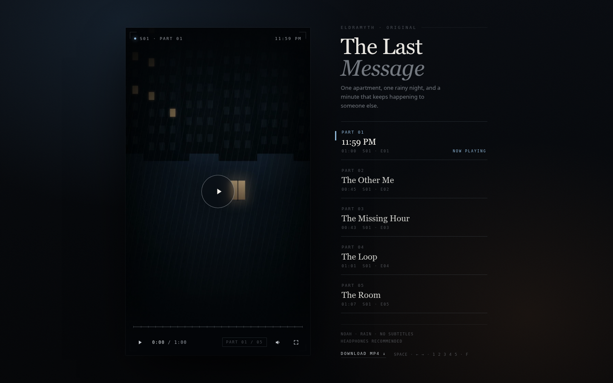
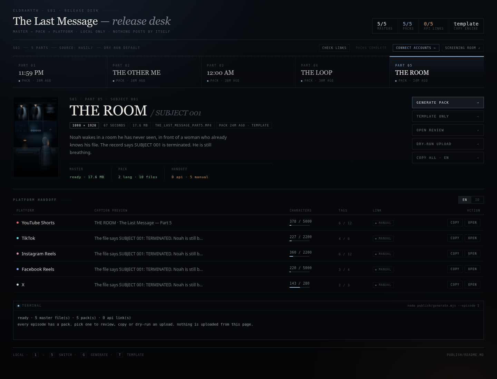
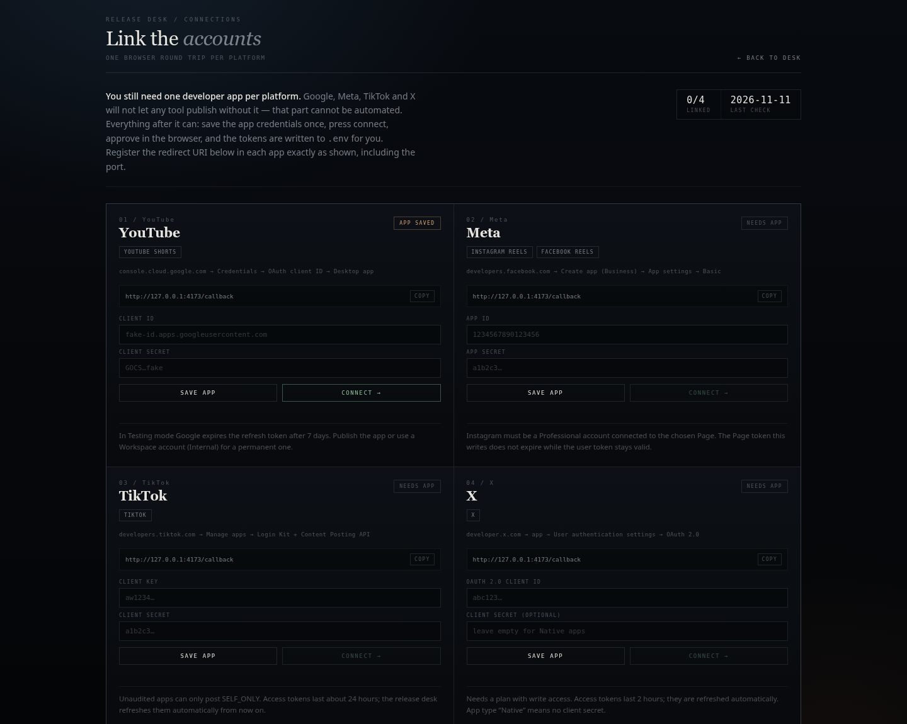

# THE LAST MESSAGE

**A six-part animated psychological thriller.**
One apartment, one rainy night, and a minute that keeps happening to someone else.



*The screening room — every episode, one player.*

> **Source-available, not open source.** The code is public to read and study.
> The story, characters, artwork and episodes may not be reused, re-uploaded or
> built upon without written permission. See [Licensing](#licensing).

---

## What this is

A serialized 2D anime short, written and voiced by EldraMyth, built entirely in
code with **React + Remotion**. No stock footage, no AI video: every frame is
vector artwork — character rigs, rain, monitors, lighting — composed in React and
rendered to 1080 × 1920 vertical video.

The series follows Noah. At 11:59 PM an unknown number tells him not to open his
door. Over six parts, the hallway, the clock, and the messages stop behaving
like things that belong to him.

| Part | Title | Runtime | Frames |
|---|---|---|---|
| 01 | **11:59 PM** | 1:00 | 1800 |
| 02 | **The Other Me** | 0:45 | 1360 |
| 03 | **12:00 AM** *(The Missing Hour)* | 0:43 | 1305 |
| 04 | **The Loop** | 1:01 | 1815 |
| 05 | **The Room** *(Subject 001)* | 1:07 | 2020 |
| 06 | **DON'T TRUST NOAH.** *(Subject 002)* | 1:23 | 2497 |

Each episode is 1080 × 1920, 30 fps, H.264 + AAC, with the supplied narration
kept intact — pauses, breaths and room tone included.

**The masters are not in this repository.** They are private deliverables; the
repository ships the code that renders them plus poster frames. See
[Licensing](#licensing) before asking for a copy.

---

## Repository layout

```
.
├─ HASIL/            posters, screening room UI (masters excluded)
├─ BAHAN/            source audio and storyboards per part
├─ public/           fonts, textures, rain, narration used at render time
├─ src/
│  ├─ character/     vector rigs — Noah, Amara, Dr. Elias
│  ├─ Episode.tsx    Part 1 + shared camera/room/grain components
│  ├─ Part2–Part6.tsx
│  └─ c5, c7, c8, c9, c10, c11.tsx   render entry points per part
├─ publish/          release desk: captions, review pages, upload adapters
├─ docs/             screenshots used by this README
└─ out/              working renders (not committed)
```

`HASIL/` holds the presentation layer — posters and the screening-room player.
`src/` holds the code that renders the episodes themselves. Episode masters stay
on the author's machine and are excluded by `.gitignore`.

---

## Requirements

- Node.js 20+ (developed on 24)
- npm
- Chrome/Chromium (Remotion renders with it)
- ~2 GB free disk for working renders

```bash
npm install
```

---

## Watch

Copy your own masters into `HASIL/` using the names the player expects
(`THE_LAST_MESSAGE_Part1.mp4` … `Part6.mp4`), then open
[`HASIL/index.html`](HASIL/index.html). The screening room plays all six parts,
remembers where you are, and keeps the poster frames.

If you only have a clone, the player still runs and shows the poster rail — the
videos are simply absent. Render your own with the commands below.

For the dashboard workflow described below:

```bash
npm run dashboard
```

---

## Rendering

Render through the per-part entry points. Do **not** use `src/index.ts` — it can
fail with `delayRender() "Loading root component"`.

```bash
# Part 1 — 60.0 s
npx remotion render src/c5.tsx  Episode out/part1.mp4 --timeout=120000 --concurrency=3 --crf=19

# Part 2 — 45.3 s
npx remotion render src/c7.tsx  Part2   out/part2.mp4 --timeout=120000 --concurrency=3 --crf=19

# Part 3 — 43.5 s
npx remotion render src/c8.tsx  Part3   out/part3.mp4 --timeout=120000 --concurrency=3 --crf=19

# Part 4 — 60.5 s
npx remotion render src/c9.tsx  Part4   out/part4.mp4 --timeout=120000 --concurrency=3 --crf=19

# Part 5 — 67.3 s
npx remotion render src/c10.tsx Part5   out/part5.mp4 --timeout=180000 --concurrency=3 --crf=19

# Part 6 — 83.2 s (finale)
npx remotion render src/c11.tsx Part6   out/part6.mp4 --timeout=240000 --concurrency=3 --crf=19
```

Grab a single frame while tuning a shot:

```bash
npx remotion still src/c10.tsx Part5 out/frame.png --frame=110
```

Renders take roughly 15–25 minutes per part on three threads.

### Output contract

- 1080 × 1920, 30 fps, H.264 + AAC
- Full narration, never stretched or re-timed
- Small `EldraMyth` watermark, upper right
- On-screen text is limited to what the storyboard allows — in Part 5 that is
  `145`, `146`, `147`, `SUBJECT 001`, `STATUS: TERMINATED`, and
  `Find the room where you were born.` In Part 6 it is `11:59`, `12:00 AM`,
  `SUBJECT 002` and `DON'T TRUST NOAH.`, plus that same `Find the room where you
  were born.` line on Noah's phone, which the storyboard calls for as diegetic
  text.
- A short black tail so the last frame is not clipped by players

---

## The release desk



`publish/` turns one vertical video into a publish pack: platform-specific
captions, hashtags, a review page, and upload adapters. It is not tied to this
series — point it at any folder of vertical videos and it behaves the same.

```bash
npm run setup                        # point the desk at a folder of videos
npm run pack -- --episode 5 --open   # captions for all five platforms
npm run pack:post -- --episode 5     # dry run: show exactly what would upload
npm run doctor                       # which accounts are actually linked
npm run dashboard                    # local control desk for all of the above
```

`npm run setup -- --dir ~/my-clips --series "Night Drive" --handle @nightdrive`
scans the folder, reads durations with `ffprobe`, grabs a poster per video with
`ffmpeg`, and writes `publish/config.json` plus `publish/episodes.json`. Existing
files are backed up, never silently overwritten. With no written brief and no
LLM key the desk still produces a clean caption from the title, part number and
runtime; a brief or an `LLM_API_KEY` makes it sharper.

What the pack contains:

```
publish/out/ep05/
├─ captions.json      source of truth (EN + ID, five platforms)
├─ review.html        edit, copy, checklist, open upload page
├─ youtube.en.txt     one file per platform per language
├─ tiktok.en.txt
└─ …
```

The review page is a local, self-contained HTML file: character counts against
each platform's real limit, editable fields, per-platform checklists, and a
button that opens the upload screen. Nothing posts by itself.

### Captions

Copy can be written by any OpenAI-compatible model (`LLM_API_KEY` in `.env`), by
hand-written briefs per episode in `publish/episodes.json`, or — with neither — by
a generic template that only uses the title, part number and runtime. Hashtags are
restricted to the pool in `config.json`, so the model cannot invent tags.
Languages are whatever you list in `config.languages`.

### Accounts — one click each



`npm run dashboard`, then open `/connect`. Paste an app's Client ID and secret
once, press **connect →**, approve in the browser, and the tokens are written to
`.env` for you. No token copying, no expiry babysitting: X (2 h) and TikTok
(24 h) access tokens refresh themselves from their refresh tokens.

The only manual part left is creating the developer app — Google, Meta, TikTok
and X all require it, so no tool can skip it. [`publish/CONNECT.md`](publish/CONNECT.md)
walks through each console, scope and redirect URI, plus the failure messages
that actually show up.

`npm run doctor` (or **check links** on the desk) then proves which account a
token belongs to, rather than merely that a token exists:

```
PLATFORM        STATUS    ACCOUNT          DETAIL
YouTube         linked    EldraMyth        channel UC…
Instagram       linked    @eldramyth       BUSINESS
TikTok          —         not configured   missing TIKTOK_ACCESS_TOKEN
```

Meta links Instagram and Facebook from a single app: pick the Page, and the Page
token plus `IG_USER_ID` are written together. Credentials live in `.env` at the
repository root (chmod 600, never committed). Uploads default to the most private
setting each platform allows: YouTube `private`, TikTok `SELF_ONLY`. Instagram and
Facebook Reels have no draft state — publishing is immediate.

---

## Notes

- Narration uses the supplied audio as-is: no re-recording, no stretching, no
  added beats.
- Part 4, Part 5 and Part 6 timelines come from forced alignment (Whisper
  `base.en`) plus `silencedetect`, so cuts follow the words actually spoken. The
  Part 6 grid was cut against the real audio length, 83.226 s, not the
  storyboard's stale 84.478 s estimate.
- Character rigs share a single visual language across all six parts: same
  faces, same scars, same light.
- `node_modules` may be a symlink in the author's working copy; a fresh clone
  just runs `npm install`.
- The upload adapters are scaffolded but not yet exercised against live accounts.
  Treat the first run of each platform as a supervised test.

---

## Licensing

This repository is **public but not open source**. Public visibility is not a
grant.

| | |
|---|---|
| Read, study, run locally | allowed |
| Quote a short excerpt with attribution | allowed |
| Copy, redistribute or mirror the code | permission required |
| Commercial use, client work, monetized channels | permission required |
| Remix, redub, translate, adapt, continue the story | permission required |
| Re-upload the episodes anywhere | permission required |
| Train or evaluate ML models on the material | permission required |
| Use characters or visual identity in your own work | permission required |

The full terms are in [LICENSE](LICENSE). For anything beyond reading, write to
the repository owner ([@maksalarina12](https://github.com/maksalarina12)) with a
one-paragraph description of the intended use. Permission is granted per request,
in writing, and does not transfer ownership.

Third-party libraries, fonts and tools keep their own licenses.
